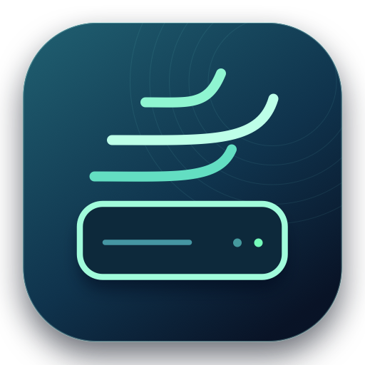

<p align="center">
  
</p>

# Aire Disco

Aplicación nativa para macOS que analiza cachés, revisa instaladores y optimiza copias idénticas. Muestra el espacio libre del volumen antes y después de cada operación. Funciona localmente y las operaciones se ejecutan con los permisos de tu usuario.

**[Descargar Aire Disco](https://github.com/psigustavocaro-star/aire-disco/releases/latest)** · macOS 14 o posterior · Apple Silicon e Intel.

## Instalar

1. Descarga `Aire-Disco-1.2-macOS.zip` desde **Releases** y descomprímelo.
2. Arrastra **Aire Disco.app** a **Aplicaciones** y ábrela.
3. En **Limpieza**, elige categorías y pulsa **Analizar**. Revisa el resultado antes de pulsar **Limpiar cachés**.

La descarga tiene firma local *ad hoc* y todavía carece de notarización de Apple. macOS puede mostrar un aviso al abrirla. Consulta la documentación de Apple para entender la comprobación antes de decidir si la abres. [Abrir apps de forma segura en el Mac](https://support.apple.com/es-cl/102445).

La versión incluye `SHA256SUMS.txt`. Si descargas ese archivo junto con el ZIP, puedes comprobar su integridad con `shasum -a 256 -c SHA256SUMS.txt` desde la carpeta de descarga.

## Cómo se usa

| Pantalla | Qué puedes hacer |
| --- | --- |
| **Resumen** | Ver el espacio libre y la capacidad del volumen de tu usuario. |
| **Limpieza** | Analizar por categoría las cachés compatibles que existan en tu Mac. Abre el detalle para ver de dónde viene el espacio detectado. Los instaladores se revisan por separado. |
| **Copias idénticas** | Elegir una carpeta de referencia y una de copias. Seleccionar los archivos que quieras optimizar tras verificar su contenido por SHA-256. |
| **Automático** | Activar la limpieza cuando el disco baje de un umbral, con un intervalo mínimo y una antigüedad de caché configurables. |
| **Actividad** | Consultar las 30 operaciones más recientes, el espacio libre antes y después y los archivos omitidos. |

Para usar la automatización, configura las categorías desde **Limpieza** y activa la opción en **Automático**. Los valores iniciales son 8 GB de umbral, 6 horas entre operaciones y cachés de al menos 2 días. La app revisa el espacio una vez por minuto mientras está en ejecución y permanece en la barra de menús si cierras la ventana. Puedes elegir **Abrir al iniciar sesión** para volver a abrirla al entrar al Mac. Tanto el inicio de sesión como la limpieza automática requieren activación desde la app.

## Alcance de la limpieza

- La automatización se limita a las ubicaciones de caché de las categorías activas. El análisis incluye varios navegadores, paquetes de desarrollo, actualizaciones y cachés web de aplicaciones Electron detectadas en Aplicaciones que usan ubicaciones compatibles.
- Los instaladores se presentan para selección manual. Su eliminación es definitiva y requiere confirmación en la app.
- Para optimizar copias, elige dos carpetas distintas de tu usuario, en el mismo volumen APFS. La comparación omite archivos que solo están en la nube, enlaces múltiples, paquetes de aplicaciones y bibliotecas multimedia. Las dos rutas se conservan y las ediciones siguen siendo independientes. [Cómo funcionan los clones APFS](https://developer.apple.com/documentation/foundation/about-apple-file-system).
- macOS puede pedir acceso a Descargas o a las carpetas que elijas. Los permisos se conceden desde macOS y el análisis de cachés sigue disponible aunque Descargas no esté accesible.
- Una parte de los archivos puede compartir ya almacenamiento. La cifra detectada mide los archivos candidatos y la actividad mide el cambio neto del volumen, incluido el uso de otras apps durante la operación.

## Compilar o revisar el código

Necesitas macOS con Xcode Command Line Tools. Desde la raíz del repositorio:

```bash
./Scripts/check.sh
./Scripts/build.sh
```

Las pruebas usan un directorio temporal y comprueban la lista de cachés permitidas, las exclusiones, la integridad de las copias y la detección de cambios durante el análisis. La compilación genera el ZIP universal y su checksum en `dist/`.

Si encuentras un problema, abre un [issue](https://github.com/psigustavocaro-star/aire-disco/issues). Incluye tu versión de macOS y los pasos para reproducirlo.
